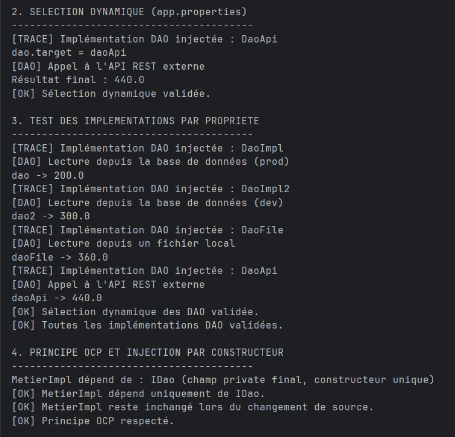
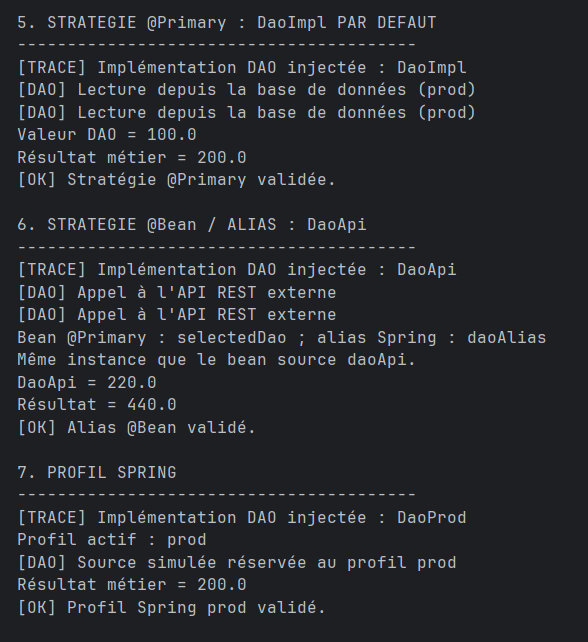
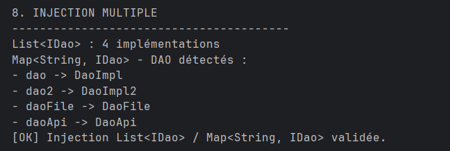

# Spring OCP - Injection de dépendances

## Sélection dynamique des DAO

Sélection dynamique de l’implémentation DAO à partir de la configuration, validation des différentes sources de données et respect du principe OCP avec injection par constructeur.

## Stratégies d’injection Spring

Validation des stratégies `@Primary`, `@Bean` avec alias et profil Spring pour sélectionner l’implémentation DAO sans modifier la logique métier.

## Injection multiple

Injection automatique de plusieurs implémentations de `IDao` sous forme de `List<IDao>` et de `Map<String, IDao>`.
